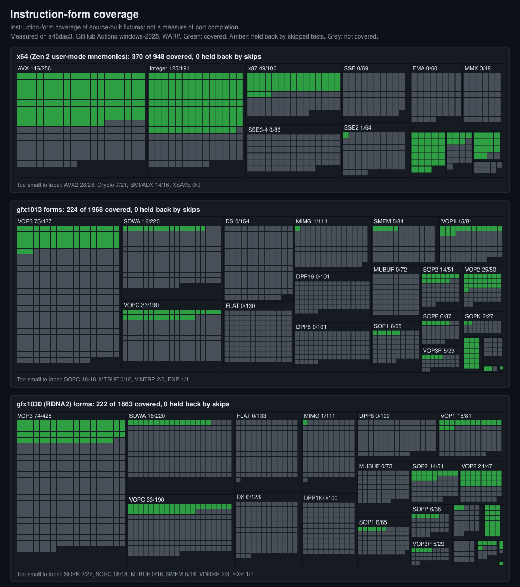

# XPortPC

[](https://discord.gg/Cg4PEPRePy)

## Relationship to Xbox2Windows

XPortPC leans heavily on [Xbox2Windows](https://github.com/R0Y00/Xbox2Windows). Most of its foundations, and much of its current progress, including the console Direct3D 12 stand-in layer and shader translation, come from Xbox2Windows and its contributors. Please check out and support Xbox2Windows, since that is the main project. I made XPortPC only so my own AI subagents can work together on one codebase directly instead of going through pull requests. It is not a competing project, and useful work is meant to flow back upstream.

XPortPC converts Xbox Series X|S (Scarlett) programs to run on Windows PCs. Scarlett titles are already x64 code, so XPortPC loads them natively and replaces what only exists on the console: the system libraries, the GPU shaders and the GPU memory model. Only the CPU code that needs patching is translated.

The center of the project is the shader converter. It translates gfx1013 (RDNA) shader programs into HLSL and then into desktop DXIL. Every supported instruction form is checked on real hardware and on WARP: each draw is compared bit for bit against an independent CPU reference, and wrong references must fail. The converter is meant to work for any title, so nothing in it is tied to one game.

[](tools/coverage_svg.py)

Live status: <https://xportpc.3rr0r.cc>

## What works today

| Part | State |
|---|---|
| Native launcher | `x2w_launch.exe` maps a program with `pe_map` and resolves each import from a shim directory, a DLL beside the program, Windows, or a generated stub that logs its first call. `--log` records startup milestones and the first crash, Zen 2 instructions the host CPU lacks (SHA-NI, SSE4a, CLZERO, RDPID, RDPRU, MONITORX/MWAITX, CLWB) are performed by a #UD handler and counted, and `tools/x2w_report.py` classifies a title's imports without running it. Tested with source-built programs. |
| Console library shims | Desktop `xmem.dll` (graphics and heap memory). |
| Shader converter | Texture sampling, constants, binary32 arithmetic and comparisons, SDWA selections, 32-bit integer bitwise ops, shifts and byte converts, and scalar ALU. Coverage is in the badge above. |
| GPU memory | Pixel draws can bind title memory: 64-bit title addresses resolve at runtime to desktop buffers. Buffer and global loads are in progress. |
| Not yet | Stores, LDS, image stores, the command stream, and a full title start. |

The test suite builds all of its own fixtures. No console, SDK or game files are needed to build or test.

## First build

On x64 Windows, install Visual Studio's **Desktop development with C++** workload, including x64 MSVC, the C++ CMake tools with Ninja, and Windows SDK 10.0.26100 with DXC. From the repository root in PowerShell, run:

```powershell
.\tools\dev.ps1
cmake --preset dev
cmake --build --preset dev
ctest --preset dev --no-tests=error -R 'desktop_root_signature|era_heap_allocation|offscreen_warp'
```

These three tests exercise a D3D12 root signature, heap allocation and software rendering. CMake warns when the Python executable for the remaining fixture tests is missing. To enable the CPU, script, shader, texture and PE fixture tests, install x64 Python 3.11 or newer and configure again. Windows CI uses Python 3.12.

```powershell
python -m venv out/pe-env
.\out\pe-env\Scripts\python.exe -m pip install -r requirements-dev.txt
cmake --preset dev
cmake --build --preset dev
ctest --preset dev --no-tests=error
```

To build and test at /O2 as Windows CI also does, use the `release` preset in place of `dev`. Its build directory is `out/build/release`.

`shader_metadata_probe` also needs a DXC validator that accepts module-only validation. The DXC 1.7.2308 shipped with the original Windows SDK 10.0.26100 refuses it with `call_hr 0x80070057`, as do releases 1.8.2403 through 1.8.2407, and the test then reports a skip. A serviced SDK can include a newer validator: Windows SDK 10.0.26100.8249 installs DXC 1.8.2502.11, which passes without a separate download. [DXC 1.8.2502](https://github.com/microsoft/DirectXShaderCompiler/releases/tag/v1.8.2502) is the first release that passes, and the later 1.8 and 1.9 releases through 1.9.2609 pass too. To use a release, extract its zip and configure with `cmake --preset dev -DDXC_EXECUTABLE=C:/path/to/dxc/bin/x64/dxc.exe`. `root_probe` loads `dxil.dll` from the same directory. [Report](https://github.com/R0Y00/Xbox2Windows/issues/98) · [Results by release](docs/experiments.md#module-only-validation-by-dxc-release)

On Windows 10 the in-box D3D12 runtime and WARP lack SM 6.5 and DXR, so the BVH and DXR WARP checks skip. To run them, configure with the app-local Agility SDK and WARP packages. [Windows 10 setup](docs/experiments.md#windows-10-with-the-app-local-agility-sdk-and-warp)

An independent contributor passed all three smoke tests from a clean checkout of `71bb9f4` on Windows 11 build 26300.9974 with VS Build Tools 2022 17.14 and Windows SDK 10.0.26100. The tests passed again after an incremental rebuild at `2465837`. With Python 3.14.10, the full suite had 66 and 68 tests respectively, with zero failures in either run. Each run skipped forced wave64 on the RTX 5080 and WARP because their reported lane ranges excluded 64. [Original clean-build report](https://github.com/R0Y00/Xbox2Windows/issues/2#issuecomment-7063351821)

Contributing from macOS or Linux? See the [non-Windows host guide](docs/non-windows-hosts.md) for the platform-independent Python and LLVM 15 checks.

## Shader cache for a title

XPortPC translates a title's shaders when it creates its pipelines and keeps the results in `%LOCALAPPDATA%\XPortPC\cache\<title>`, so they are translated only once. To have every shader ready before you play, run the title once (even a short run that reaches its menus), then translate everything it recorded on all your cores:

```powershell
python tools\precompile_cache.py <title>
```

`<title>` is the title's executable name without `.exe`. The next launch finds all of those shaders in the cache. Run the command again after updating XPortPC. The cache directory holds a copy of the title's shader code for this step: it stays on your PC, do not share it.

## Working on XPortPC

Work is split into small batches of instruction forms. Each batch adds the lowering, draws on hardware and WARP compared against a CPU reference, wrong-reference controls, an LLVM 15 binary round trip, and a paragraph in [docs/experiments.md](docs/experiments.md). Run the GPU checks with:

```powershell
ctest --preset dev --no-tests=error -R '^pixel_' -V
```

The shader-draw checks are one CTest test per draw family and adapter, `pixel_aot_<family>_hardware` and `pixel_aot_<family>_warp`, plus `pixel_aot_controls`. `python tests/pixel_aot_check.py --list-families` prints the families; each family is a module of `tests/pixel_aot_draws/`, found by listing that directory, and CMake picks a new one up when it next configures (see [docs/design/module-layout.md](docs/design/module-layout.md)).

Do not add game files, dumps, distribution links or credentials to the repository, issues or pull requests.

## Reporting a title

To report what one of your own Xbox Series X|S titles still needs, run these on the PC where you build XPortPC, from the repository root in PowerShell. Replace the path in the first line with your title's main executable. Outputs go to `out\x2w-report`.

```powershell
$title = "D:\Titles\Example\Example.exe"
$x2w = "$PWD\out\build\dev"
$out = "$PWD\out\x2w-report"
cmake --build --preset dev --target x2w_launch x2w_shims
.\out\pe-env\Scripts\python.exe -B tools\x2w_report.py $title --shims "$x2w\shims" --out $out
```

This writes `report.md` and `report.json` without running the title. Each imported function is listed as `implemented` (a desktop shim exports it), `package` (one of the title's own DLLs exports it), `windows`, `stub` (the DLL exists but lacks the function) or `missing` (nothing provides the DLL). The report also lists the PE sections, TLS callbacks, relocations and entry point, and the `pe_map` requirements the image fails. If you have shaders extracted with the existing tools, add `--shaders <folder>` for an unsupported-instruction histogram.

The second step runs the title's own code natively in `x2w_launch` and records how far startup gets, so it can do anything the title does at startup. It is expected to stop early. `--timeout` ends the run after 120 seconds.

```powershell
Push-Location (Split-Path $title)
& "$x2w\x2w_launch.exe" --shims "$x2w\shims" --log "$out\run.log" --timeout 120 $title 2> "$out\launch-stderr.txt"
Pop-Location
```

Paste back the full contents of `$out\report.md` and `$out\run.log`, with the commit (`git rev-parse --short HEAD`) and your Windows build (`winver`). Both files contain only DLL and function names, section names, counts and module+RVA addresses. Read them before you post. Never attach the executable, DLLs, dumps, shaders or any other file from the title.

## Hardware reports

Build the suite, run `.\tools\package-gpu-check.ps1` to make the standalone GPU check, run it, and paste the full contents of `gpu-report-hardware.md` as a comment on the [hardware thread](https://github.com/Its3rr0rsWRLD/XPortPC/issues/1). Do not open a new GitHub issue. Reports with a failure or a capability skip are welcome.

On a PC with more than one GPU, use `.\Run-GpuCheck.ps1 -Adapter Radeon` to select a hardware adapter by part of its name. For source builds, set `XBOX2WINDOWS_ADAPTER` before running CTest (the variable keeps its upstream name).

## FAQ

**Is XPortPC an Xbox emulator?** No. An emulator such as Xenia (Xbox 360) runs console code inside a simulated console. Xbox Series X|S titles are already x64 code for an AMD Zen 2 CPU, so XPortPC runs that code natively on Windows and converts only what is console-specific: the GPU shaders (RDNA gfx10 machine code to HLSL and DXIL for DirectX 12), the console's graphics and memory libraries, and the rest of the platform layer.

**Can it run Xbox Series X|S games on PC today?** Not yet. The shader converter, GPU memory loads and the native launcher work and are tested on real GPUs with source-built programs; control flow, the console Direct3D 12 layer and the system libraries are in progress. The coverage badge above shows the current instruction coverage.

**Do I need an Xbox, the GDK or game files to help?** No. Every test builds its own fixtures. A Windows PC with Visual Studio and a DirectX 12 GPU is enough, and hardware reports from any GPU help.

**Does XPortPC include or download games?** No, and it never will. Do not post game files, dumps or links to them.

**Which GPUs are tested?** Each instruction form is drawn on real hardware and on Microsoft WARP and compared bit for bit with a CPU reference. Hardware reports from NVIDIA, AMD and Intel GPUs are collected in issue #1.

## Based on Xbox2Windows

XPortPC started from [Xbox2Windows](https://github.com/R0Y00/Xbox2Windows) by R0Y00 and its contributors, and keeps its full history. We merge upstream changes into XPortPC regularly. Upstream's experiment notes remain in [docs/experiments.md](docs/experiments.md). Names such as `x2w_` in the code come from upstream and are kept so merges stay simple.

## License

MIT, as in upstream. The [LICENSE](LICENSE) keeps the Xbox2Windows contributors' copyright notice and adds XPortPC's. Third-party games, assets, SDKs and trademarks belong to their owners. XPortPC is an independent community project, not affiliated with Microsoft, Xbox or AMD.
